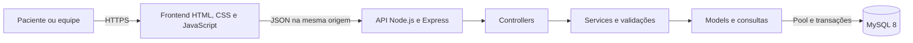

# Decisões arquiteturais

## Contexto

O sistema recebe respostas simultâneas, mantém histórico, aplica permissões por setor, calcula indicadores e armazena consentimentos e registros de auditoria. O ambiente de implantação previsto é uma instituição com equipe de TI, servidor Node.js e banco MySQL.

## MySQL 8 como SGBD

**Decisão:** utilizar banco relacional MySQL 8 com InnoDB.

**Justificativa:** os dados possuem relacionamentos claros entre setores, usuários, perguntas, avaliações e respostas. O sistema precisa de transações para concluir avaliações e alterar configurações sem gravar estados pela metade. Chaves estrangeiras, índices únicos, colunas geradas e `CHECK constraints` reforçam no banco regras críticas como um administrador ativo por setor, uma pergunta NPS por setor e telefone somente com consentimento. O MySQL também oferece agregações e `JSON_TABLE`, usados nos relatórios sem transferir centenas de milhares de respostas ao Node.js.

O JSON foi limitado às listas variáveis de alternativas e respostas de múltipla escolha. Identidades, permissões, avaliações e métricas permanecem relacionais e indexáveis.

**Alternativas consideradas:**

| Alternativa | Vantagem | Motivo para não escolher nesta versão |
| --- | --- | --- |
| PostgreSQL | Recursos SQL avançados e excelente suporte a JSON | Não traria benefício decisivo para o escopo atual e aumentaria a distância do ambiente MySQL já disponível no cliente |
| MongoDB | Flexibilidade para questionários variados | Regras relacionais, transações, auditoria e relatórios agregados exigiriam mais lógica na aplicação |
| SQLite | Implantação simples | Menos adequado ao acesso concorrente, à operação institucional e ao crescimento do volume |

**Consequências:** a aplicação depende do MySQL 8 e de recursos como `JSON_TABLE`. Migrações e backup precisam fazer parte da operação. Em troca, regras essenciais ficam protegidas abaixo da camada HTTP.

## Node.js e Express

**Decisão:** backend em Node.js, CommonJS e Express 5.

**Justificativa:** o produto é predominantemente orientado a entrada e saída: HTTP, consultas ao banco, exportação e arquivos estáticos. Node.js atende bem esse perfil e permite compartilhar a linguagem JavaScript com o frontend. Express fornece uma camada pequena e conhecida para rotas e middleware, enquanto bibliotecas específicas tratam cookies, JWT, limitação de requisições, segurança de cabeçalhos e Excel.

**Alternativas consideradas:** Java/Spring e C#/.NET ofereceriam tipagem e ecossistemas corporativos fortes, mas exigiriam outra cadeia de implantação e maior custo de desenvolvimento para a equipe atual. Um framework frontend completo também foi evitado porque as telas não exigem renderização no servidor ou uma cadeia de build complexa.

## Monólito modular

**Decisão:** uma aplicação implantável, separada internamente em `routes`, `controllers`, `middleware`, `services`, `models`, `validations`, `config` e `utils`.

Essa escolha reduz custo operacional, mantém autenticação e transações na mesma unidade e é suficiente para uma implantação por hospital. A modularização permite testar e evoluir responsabilidades sem introduzir a complexidade de rede, observabilidade e consistência distribuída dos microsserviços.

Microsserviços só se justificariam com equipes independentes, cargas muito diferentes ou necessidade comprovada de escalar módulos separadamente. Esses sinais ainda não existem no projeto.

## Frontend e mesma origem

O frontend usa HTML, CSS e JavaScript sem etapa de build. O Express serve apenas os diretórios públicos e mantém interface e API na mesma origem. Isso simplifica implantação, cookies e política de conteúdo, reduz dependências e funciona bem para terminais, celulares e TVs institucionais.

A limitação é que parte do painel ainda manipula a coleção completa no navegador. A evolução prevista é paginar também gráficos e contatos quando medições no ambiente real justificarem essa mudança.

## Segurança e privacidade por projeto

- Senhas são protegidas com bcrypt; sessões usam JWT em cookie inacessível ao JavaScript.
- Autorização é verificada no servidor em toda rota administrativa.
- Consultas usam parâmetros; entradas passam por validação de tipo e tamanho.
- Respostas autenticadas e dados de contato recebem `Cache-Control: no-store`.
- O visualizador não recebe telefone nem observações, inclusive no JSON.
- Logs técnicos não armazenam corpos, tokens, senhas ou mensagens SQL completas.
- Consentimento de pesquisa e autorização de contato são eventos distintos.

## Escalabilidade e limites conhecidos

A paginação por cursor e a agregação SQL removem os antigos cortes fixos. A exportação usa escrita em streaming. Uma instância pode crescer verticalmente e usar réplicas de leitura antes que uma arquitetura distribuída seja necessária.

Ainda precisam ser medidos no destino: concorrência de preenchimentos, memória do painel com períodos longos, latência da exportação e tempo de restauração. A versão atual não é multiempresa; a escala comercial inicial ocorre por instâncias isoladas, o que favorece privacidade, mas aumenta o custo operacional.
